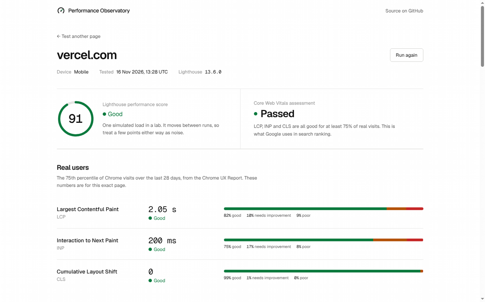
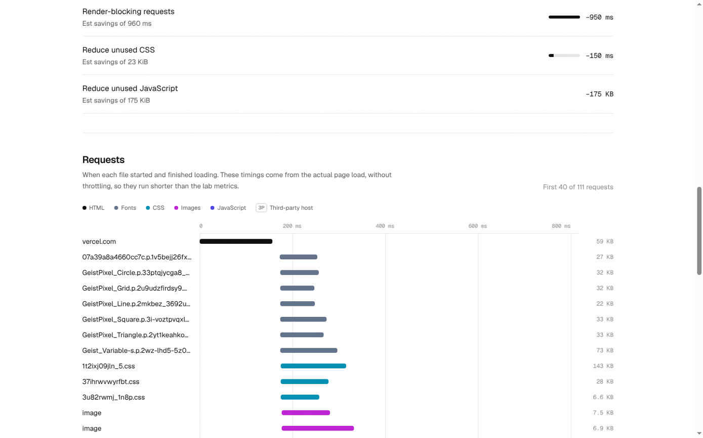
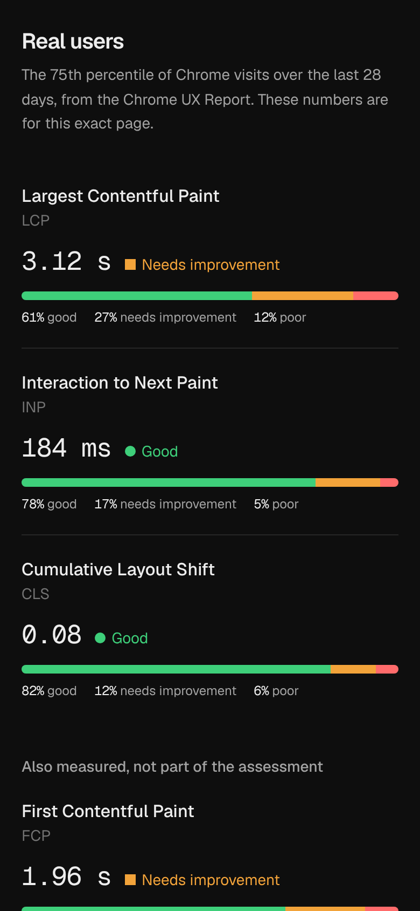

# Performance Observatory

**Paste a URL, get a performance report you can act on.** Real-user Core Web Vitals from the Chrome UX Report sit next to a Lighthouse lab test, along with the fixes worth making first, every request on a timeline, and what the page actually downloads.

[**Try it live**](https://sites-peformance-observatory.vercel.app/) &nbsp;&nbsp; [See a sample report](https://sites-peformance-observatory.vercel.app/result?sample=1) &nbsp;&nbsp; [JSON API](#json-api)



## Why it exists

PageSpeed Insights has all the data, but it buries the question most people are asking: *is this page fast for the people using it, and what should I fix?* The Observatory answers that in one page.

- **Real users first.** The Core Web Vitals verdict is computed the way Google computes it for search: LCP, INP and CLS must all be good at the 75th percentile of 28 days of Chrome visits. Each metric shows the full good / needs improvement / poor split, so you can see whether "needs improvement" means 26% of visits or 60%.
- **The lab test, kept in its place.** The five Lighthouse metrics come with their score and their weight in the overall score, so it's obvious why the score moved. The page says plainly that this is one simulated load and meant for debugging.
- **Fixes ranked by impact.** Failing audits are sorted by Lighthouse's estimated time saved, then bytes, then layout shift, rather than listed alphabetically.
- **What really loaded.** A request waterfall with third-party hosts marked, and page weight by type in compressed bytes.
- **Honest when data is missing.** New sites without enough Chrome traffic get "Not enough data" and an explanation. When a page only has whole-site data, the report says so. Failures get a specific message, never made-up numbers.



## It passes its own test

Run on itself, the Observatory scores **100 on mobile** in Lighthouse 13.6. LCP is 757 ms, Total Blocking Time is 8 ms, and the whole home page is 299 KB across 21 requests. [Check it yourself](https://sites-peformance-observatory.vercel.app/result?url=https%3A%2F%2Fsites-peformance-observatory.vercel.app%2F&strategy=mobile).

That's down to a few deliberate choices:

- **No chart, animation or icon libraries.** Every bar, gauge and waterfall is plain HTML, CSS and SVG, so none of it adds JavaScript.
- **Reports render on the server.** The PageSpeed call, the parsing and the markup all happen in a React Server Component. The browser receives finished HTML and hydrates only four small client components: the URL form, the recent-tests list, the history recorder and the loading timer.
- **Self-hosted fonts** through the `geist` package, so there's no request to a font CDN at runtime.
- **Five-minute caching** per URL and device. Revisits are instant, and "Run again" deliberately skips the cache.

## Engineering notes

**A parser that survives Lighthouse upgrades.** The raw PageSpeed response is typed in `lib/psi/raw.ts` with every field optional, and `lib/psi/parse.ts` reads it defensively. It handles the Lighthouse 10 rename of request timings (`startTime` → `networkRequestTime`), the newer insight audits that report savings through `metricSavings`, CrUX's convention of storing CLS multiplied by 100, and the fallback from page-level to origin-level field data. It's running in production against Lighthouse 13.6.

**Errors you can act on.** PageSpeed and Lighthouse failures are mapped to typed `ReportError` codes: missing key, quota, invalid URL, unreachable page, timeout and upstream error. Each one has its own message and next step, and the JSON API returns a matching HTTP status. Bare domains like `example.com` are normalised, and private or local addresses are rejected before a slow round trip.

**A sample report that runs the same code.** `/result?sample=1` feeds a PageSpeed-shaped fixture through the production parser, so the demo can't drift from the real thing. It's labelled as sample data on the page.

**Accessible by default.** Ratings use Lighthouse's shape convention (circle, square, triangle) as well as colour. Data sits in semantic tables. Light and dark follow the system setting, the form works fully by keyboard, and animations respect `prefers-reduced-motion`.



## JSON API

```
GET /api/analyze?url=example.com&strategy=mobile
```

Returns the same `Report` object the page renders (see `lib/report.ts`): score, field and lab metrics, fixes, requests and page weight. Errors come back as `{ "error": { "code", "message" } }`:

| Status | Code | Meaning |
| --- | --- | --- |
| 400 | `invalid-url` | Not a public http(s) address |
| 422 | `unreachable` | Lighthouse couldn't load the page |
| 429 | `quota` | The PageSpeed Insights quota is used up |
| 502 | `upstream` | PageSpeed Insights returned an error |
| 503 | `missing-key` | No `PSI_API_KEY` is configured |
| 504 | `timeout` | No answer within 55 seconds |

## Run it locally

```bash
git clone https://github.com/Mohamed0Hussein/sites-performance-observatory.git
cd sites-performance-observatory
npm install
cp .env.example .env.local   # add your PSI_API_KEY
npm run dev
```

Google no longer serves keyless PageSpeed requests, so you'll need a free [PageSpeed Insights API key](https://developers.google.com/speed/docs/insights/v5/get-started#APIKey). Without one, the sample report at `/result?sample=1` still works.

To deploy, import the repo into Vercel and add `PSI_API_KEY` as an environment variable.

## Stack and structure

Next.js 16 (App Router), React 19, TypeScript in strict mode, and Tailwind CSS 4. The only runtime dependencies are `next`, `react`, `react-dom`, `geist` and `server-only`.

```
app/
  page.tsx               home: URL form and recent tests
  result/page.tsx        server-rendered report
  result/loading.tsx     streams instantly and shows elapsed time
  api/analyze/route.ts   JSON endpoint
lib/
  psi/fetch.ts           calls PageSpeed Insights, maps failures to ReportError
  psi/parse.ts           raw response -> Report
  psi/raw.ts             types for the raw API response
  psi/sample.json        fixture behind /result?sample=1
  report.ts              the Report model the UI renders
  thresholds.ts          Web Vitals thresholds and Lighthouse score bands
components/report/       one component per report section
```

## Author

Built by **Mohamed Hussein**, a full stack engineer in Cairo focused on React, Next.js and web performance.

[GitHub](https://github.com/Mohamed0Hussein) &nbsp;&nbsp; [LinkedIn](https://www.linkedin.com/in/mohamed-hussein-0x1/)
